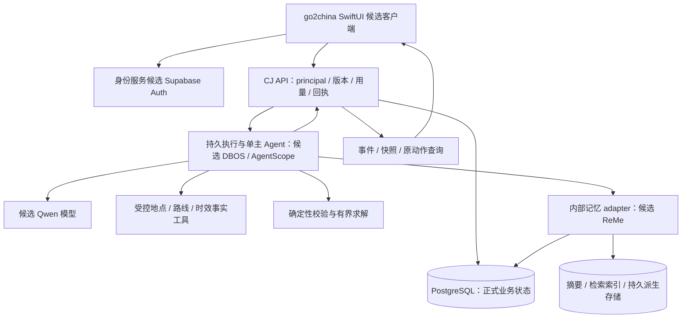

# 架构与数据流

状态：逻辑设计；技术实现按 [ADR-0002](adr/0002-runtime-candidates.md) 验证，正式状态策略按 [ADR-0003](adr/0003-state-and-recovery.md) 收敛。此图不表示已有服务或部署。

## 模块职责

| 模块 | 拥有的职责 | 接口与禁止越界 |
|---|---|---|
| App 壳与展示 | 四 Tab、双语、输入/流式/错误/离线状态、记忆管理 UI | UI/AUTH/RUN 等契约；不持有服务器秘密、不直写正式业务库 |
| 身份与用量 | 从真实会话得到 principal、账号代次；派发前准入/预留与结算 | AUTH/USAGE；客户端 user_id 不能决定归属，后台整理同样受限额 |
| 消息与执行 | 持久接收、投递恢复、同聊天顺序、事件/快照、停止与单一终态 | MESSAGE/RUN；运行完成不等于所有副作用成功或全部回滚 |
| 记忆领域 | 正式条目/来源/版本/授权、纠正/启停/删除与上下文有效性 | MEMORY/CLEANUP；摘要/向量/角色文件不能争夺正式值 |
| 需求与旅行证据 | 需求口径、地点身份/坐标、时效来源、可行性与求解 | NEEDS/PLACE/FACT/FEASIBILITY；无结果、失败、未知分开 |
| 旅程领域 | 不可变候选、接受拒绝、唯一正式事务写入、局部保护/版本与读取 | TRIP；模型文本和工具建议不能直接变为正式旅程 |
| 清理与反馈/运行 | 全域私有存储登记、清理 hook、可定位反馈、环境恢复证据 | CLEANUP/FEEDBACK/OPS；反馈不扩为人工接管或运营 Agent |

这些是责任划分，不要求每行都部署成独立微服务。共享契约集中一处，只有真实变化点才设 adapter，不为假想扩展建设框架。

## 主要数据流

1. **提出请求：** App 带真实会话与稳定动作标识提交；API 校验 principal/账号代次、输入与准入，持久化消息/接收记录后派发。接收和派发间崩溃可恢复；回执未知时查原结果，不能换 ID 重发。
2. **构建上下文：** 合并当前消息、明确旅程绑定与最新有效记忆；按授权、适用范围、期限、来源与撤回版本过滤。原消息/检索文本只作资料，不得改变工具权限。基础聊天和摘要允许没有 Trip。
3. **查询和建议：** 受控工具查询地点/路线/时效事实，保留来源、坐标系、查询时间及适用日期；模型提出候选，程序校验时间/预算/固定事项并必要时有界求解，未知不填零或免费。
4. **确认写入：** UI 展示候选和待核实项；用户接受精确内容与旅程版本，API 事务检查后保存正式版本和动作回执。拒绝不写正式旅程；局部修改展示范围及连带影响，扩大范围需确认。
5. **恢复与记忆：** 事件中断后读取快照/游标和原运行；及时增量与结束摘要经同一记忆生命周期处理，归纳候选确认后才激活；详情保留来源与大致时间。
6. **纠正/撤回：** 提交新版本与失效屏障，立即限制上下文/晚到任务；异步清理摘要、索引、缓存和必要 checkpoint，逐域记录完成/失败。重建或备份恢复先重放撤回依据再开放检索。

## 数据归属与信任

正式业务状态、身份会话、执行 checkpoint、记忆派生存储、设备缓存及外部 provider 处理范围均需登记 owner、用户归属、敏感字段、留存与删除入口。CJ-005 维护统一登记，领域票补充自身清理 hook；CJ-024/027 最终组合验证。当前没有表名、schema、存储资源或地域定案。

API 在所有读写、事件订阅、检索、后台任务和结果返回处校验账号归属；账号切换后的晚到结果不能落入新账号。记忆组件只在内部调用；用户隔离需真实账号/权限测试，不能用单一过滤条件或组件 demo 代替。

供应商返回、网页、历史摘要、模型文本属于不可信输入。工具出口限定用途/目标，网页获取需防提示注入和受限网络访问；模型不能借来源文本、格式化内容或重试改变权限。日志只留必要定位标识与脱敏诊断，不默认持久记录完整敏感提示词。
