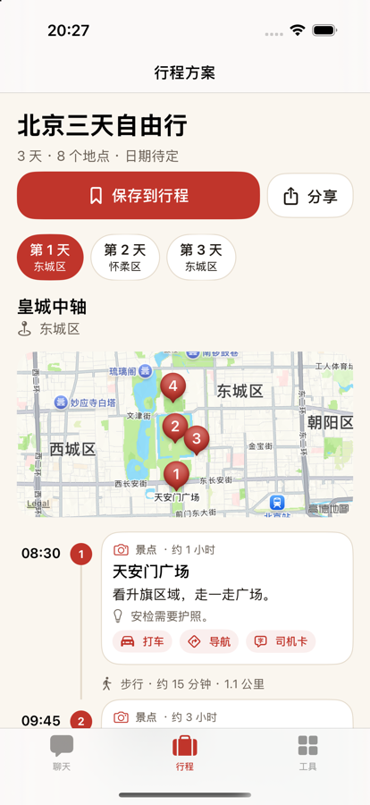
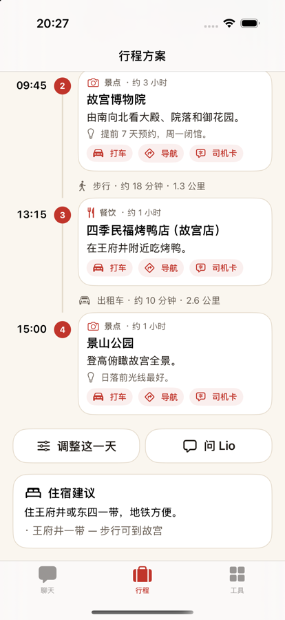
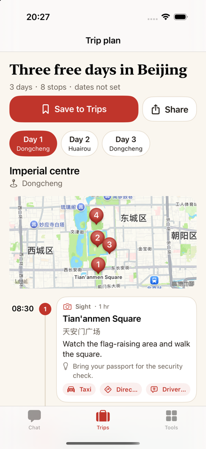

# 行程结构化展示：研究与方案（#1453，构建 55）

状态：**JT 2026-11-24 已确认**（[#1453 记录](https://github.com/JTCAO515/G2C/issues/1453#issuecomment-7131756850)）；服务端按 JT 选的 (a)：只有「规划」走第 4 版（`/v4/lio/messages`，`structured.4`），其余聊天不变。实现放构建 56。截图来自分支上的 SwiftUI 原型，用北京三天的公开知名地点做演示数据（坐标为近似值，仅用于截图）。

## 问题

问「帮我规划三天北京自由行」，构建 54 只回一段纯文本。App 其实已有两套行程展示：聊天里的行程卡（`LioItinerary`：按天、地点名、时间、坐标）和更完整的富行程（`LioRichItinerary`：每天主题与区域、站点类型、简介、备注、贴士、站间交通方式与耗时、地图、司机卡、住宿建议，见 `lio-rich-itinerary.md`）。富行程只接在第 4 版对话的 `structured.4` 上，而第 4 版不是默认对话，所以内测用户看不到。

## 主流产品的做法（归纳）

| 产品 | 呈现方式 | 可借鉴 |
|---|---|---|
| Wanderlog | 按天列表 + 同屏地图，站点之间显示步行/驾车时间，可一键优化顺序 | 站间交通行、地图与列表编号一致 |
| Google 旅行 / Google 地图「行程」 | 按天卡片，地点带图片、简介、营业时间，可在地图上看当天路线 | 每天一张地图、地点简介一句话 |
| TripIt | 严格按时间轴，适合航班酒店等确定事项 | 左侧时间锚点 |
| 携程 / 马蜂窝行程 | 第 N 天 + 当天区域，时间轴卡片，交通段单独一行，含门票预约提醒 | 「第 N 天 · 区域」标签、预约/闭馆提醒 |
| ChatGPT / Gemini 等 AI 助手 | 先给文字，再给可保存/可修改的结构化行程 | 「保存」「调整这一天」作为对话动作 |

共同点：**按天切换 → 当天地图 → 时间轴站点卡 → 站间交通 → 每站快捷操作**；整体操作是保存与分享，局部操作是改某一天。

## 方案

1. **顶部**：行程标题、「3 天 · 8 个地点 · 日期待定」、主按钮「保存到行程」、次按钮「分享」。
2. **按天切换**：胶囊按钮「第 1 天 · 东城区」，当前天为朱红实底。
3. **当天信息**：主题（如「皇城中轴」）与区域；当天地图，标记编号与下方站点一致；没有核实坐标的站点不上图、编号不变。
4. **时间轴**：左侧时间，中间编号与连线，右侧站点卡：类型图标（景点/餐饮/住宿/交通/自由活动）与建议时长、名称（英文界面附中文名）、一句话简介、贴士（预约、闭馆、安检）、快捷操作「打车 / 导航 / 司机卡」（只有核实过的地址才可用）。
5. **站间交通**：步行 · 约 15 分钟 · 1.1 公里；没有估算时写「交通安排待定」，不编造。
6. **当天操作**：「调整这一天」「问 Lio」——发回聊天，由 Lio 改当天并生成新版本，旧版本可撤销（沿用现有行程版本与撤销）。
7. **住宿建议**：区域与 2–3 个建议，不显示价格与预订。
8. **入口**：聊天里出现行程卡，点开即本页；保存后在「行程」Tab 打开同一页。

数据全部来自现有 `LioRichItinerary` 字段；「建议时长」放在 `note`，不新增字段。

## 需要 S 确认（复用已有结构，不把第 4 版对话切为默认）

- 默认对话在回答行程规划时，能否像现有行程卡一样附带结构化行程，并填入 `structured.4` 已有的富字段（类型、简介、备注、贴士、站间估算、住宿建议）；或给出只在行程卡读取路径上启用富字段的方案。
- 地点坐标与地址的核实来源（`matched`），以保证打车/司机卡只对核实地址开放。
- 「调整这一天」的请求形式（沿用现有修改/撤销接口）。

## 请 JT 确认

1. 页面结构（顶部、按天切换、当天地图、时间轴、站间交通、当天操作、住宿建议）。
2. 每站三个快捷操作：打车、导航、司机卡。
3. 「调整这一天」走聊天，由 Lio 生成新版本并可撤销。
4. 本版先做展示与保存，分享、优化顺序放后续。

已知原型问题：英文按钮在窄屏会截断，定稿时改短（Taxi / Map / Driver）。

## 截图

| 第 1 天（中文） | 时间轴（中文） | Day 1 (English) |
|---|---|---|
|  |  |  |

## 构建 56 实现：摘要版（#1453）

服务端现状（S 2026-11-25 核实）：香港还没注册富行程详情读取 `GET /v7/trip-structured`（TRIP-structured-read.3），库里也还没有 structured.4。S 正在补这条路由，并实跑「/v4 规划 → 保存 → /v7 读回」。在那之前，App 只用第 4 版回复里的行程摘要卡（`LIO-trip-card.3`，也兼容 `.2`）：

- 聊天：第 4 版回复带行程卡时，回复下方出现「行程方案」卡（标题、天数、地点数），「按天查看」打开按天页。
- 按天页沿用本方案的结构，但摘要里没有的内容不显示、不编造：没有站点类型标签、简介、贴士、站间交通、当天地图和住宿建议；地点都未核实，所以没有打车、导航、司机卡。空的一天显示「这一天还没有安排」。
- 保存到行程：存在本机（每个行程一份，新版本覆盖旧版本），「行程」Tab 列在最前，长按可移除。服务端行程本身已由规划保存，这里只是收藏到本机列表。
- 分享：系统分享面板，内容是标题加每天的时间和地点。
- 调整这一天 / 问 Lio：关闭按天页回到聊天，输入框预填「调整「标题」第 N 天：」，由用户补充后发送；输入框已有草稿时不覆盖。
- 站点类型新增 `unspecified`，只给摘要用，标签为空。

/v7 通了以后，按天页改读详情，补回类型、简介、贴士、交通、地图、住宿和三个快捷操作；「规划行程」显式入口另做。
