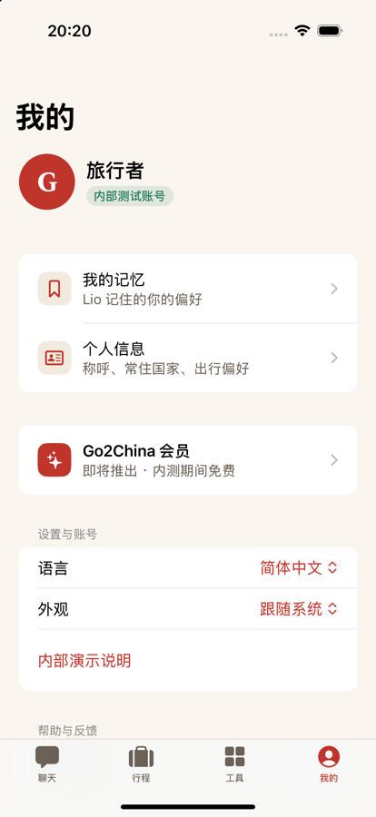
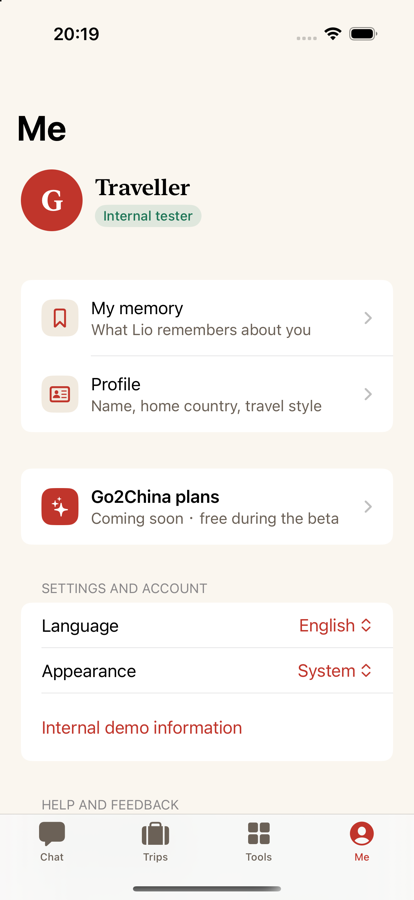
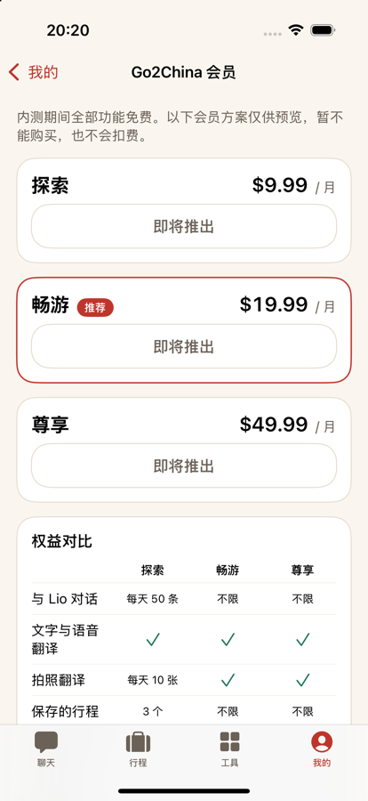
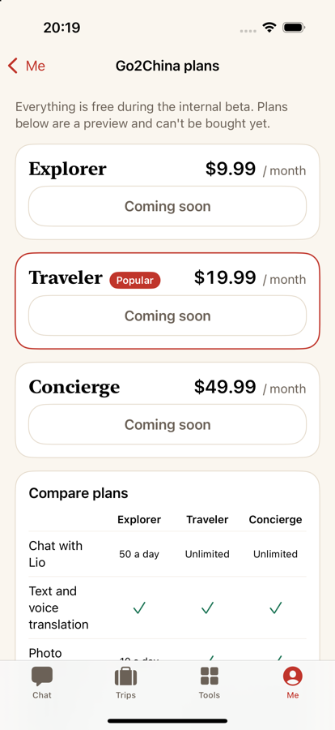
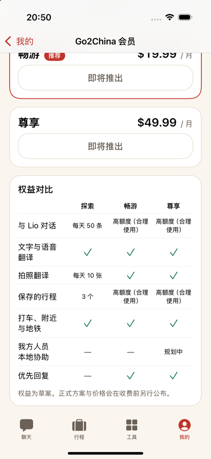

# 「我的 / Me」与订阅占位（#1452，构建 55）

状态：**JT 2026-11-24 已确认**（#1452，协调线程转达），按确认实施。截图来自分支上的 SwiftUI 原型（iPhone 16 Pro 模拟器，Debug 预览数据）。

## 信息架构

Tab 由「聊天 / 行程 / 工具 / 记忆」改为 **聊天 / 行程 / 工具 / 我的**。

| 位置 | 内容 | 来源 |
|---|---|---|
| 我的 · 顶部 | 头像首字母、称呼（默认「旅行者」）、「内部测试账号」标签 | 新增 |
| 我的记忆 | 原「记忆」Tab 整页，入口移到这里 | 原记忆 Tab |
| 个人信息 | 称呼、常住国家、语言、饮食与出行偏好；由 Lio 从「我的记忆」整理，可修改或清除 | 新增（本版先只读占位） |
| Go2China 会员 | 订阅占位页（见下） | 新增 |
| 设置与账号 | 语言、外观、内部演示说明、注销账号、退出登录 | 原聊天菜单 |
| 帮助与反馈 | 反馈方式（内部测试群发截图、问题记录、时间）；以后放常见问题 | 新增 |

聊天左上角菜单只保留「新对话」「历史对话」。

## 订阅占位

- 三档（每月，美元）：**探索 Explorer $9.99**、**畅游 Traveler $19.99（推荐）**、**尊享 Concierge $49.99**。
- 每档只有灰色「即将推出」按钮；页首写明「内测期间全部功能免费。以下会员方案仅供预览，暂不能购买，也不会扣费」。
- 权益对比为**草案**：Lio 对话（50 条/天 · 高额度（合理使用）· 高额度（合理使用））、文字与语音翻译（全含）、拍照翻译（10 张/天 · 含 · 含）、保存的行程（3 个 · 高额度（合理使用）· 高额度（合理使用））、打车/附近/地铁（全含）、我方人员本地协助（尊享「规划中」，不承诺服务时间）、优先回复（畅游、尊享）。不写「不限」。
- 不接任何支付、不引入 StoreKit、不调用购买接口；真实收费由 JT 另行决定。

## JT 确认结果（2026-11-24）

1. Tab：聊天 / 行程 / 工具 / 我的 —— 同意。
2. 三档名称、价格与「推荐」在畅游 —— 同意。
3. 权益对比：畅游、尊享的对话与行程改为「高额度（合理使用）」；本地协助标「规划中」；其余保留。
4. 个人信息本版只读，编辑放后续版本。

## 截图

| 我的（中文） | 我的（English） |
|---|---|
|  |  |

| 会员（中文） | Plans (English) | 权益对比（确认后） |
|---|---|---|
|  |  |  |
