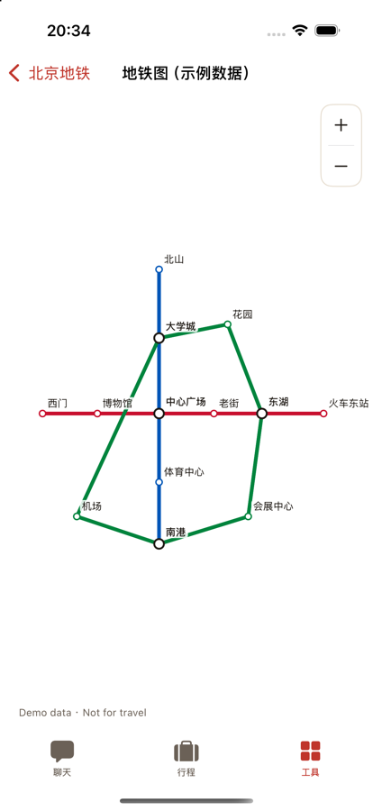
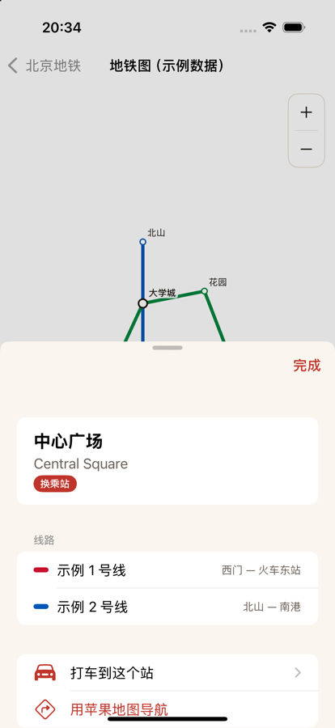

# 可交互地铁图（#1454，构建 55）

状态：**App 渲染与交互框架已完成（示例数据）**；广州、上海、北京真实数据由 S 产出，数据来源（拟 OpenStreetMap，ODbL）**待 JT 确认授权**并在授权清单登记后接入。不使用来源不明的线路图图片，不用第三方付费组件。

## 交互

- 原生绘制（SwiftUI `Canvas`）：线路按官方颜色绘制，换乘站为白底黑圈的大圆点，普通站为线路色小圆点；站名在点的右上方，带浅底色避免压线。
- 双指缩放（1–5 倍）、拖动平移；右上角「+ / −」按钮；回到 1 倍时自动归位。
- 点站名弹出面板：中英站名、「换乘站」标签、所经线路（颜色、线名、两端终点站，环线标「环线」）、「打车到这个站」（进入现有打车页，终点预填该站坐标）、「用苹果地图导航」。
- 左下角固定显示数据来源与许可（如「OpenStreetMap contributors · ODbL-1.0」），可点开来源页面。

## 数据格式 `METRO.1`（随包 JSON，每城一个文件，S 产出）

```json
{
  "version": "METRO.1",
  "city": "guangzhou",
  "data_version": "2026-11-24.1",
  "source": {"name": "OpenStreetMap contributors", "license": "ODbL-1.0",
             "url": "https://www.openstreetmap.org/copyright"},
  "lines": [
    {"id": "gz-3", "name_zh": "3号线", "name_en": "Line 3", "color": "#ECA154",
     "stations": ["gz-tiyuxilu", "gz-zhujiangxincheng"]}
  ],
  "stations": [
    {"id": "gz-tiyuxilu", "name_zh": "体育西路", "name_en": "Tiyu Xilu",
     "lat": 23.1316, "lng": 113.3216, "coordinate_system": "WGS-84",
     "x": 0.52, "y": 0.41}
  ]
}
```

规则（App 解码时逐条校验，任一不符整份拒绝）：

- `version` 必须为 `METRO.1`；`source.url` 必须是 https，`name`、`license` 非空。
- 线路：`id` 唯一；至少 2 个站；所有站 ID 必须存在；`color` 为 `#RRGGBB`；中英线名非空。环线首尾重复同一站。
- 站点：`id` 唯一；中英站名非空；`lat`/`lng` 合法；`coordinate_system` 为 `WGS-84` 或 `GCJ-02`（打车按此坐标系提交）。
- `x`/`y` 为示意图位置（0–1，原点左上），可选但须成对；**全部站点都有时按示意图绘制**，否则按经纬度等比例投影（北在上）。建议 S 提供示意图坐标，城市大时可读性更好。
- 站点所属线路由 `lines[].stations` 推出，不在站点里重复写；属于 2 条以上线路即为换乘站。

## 待办

- JT：确认 OpenStreetMap（ODbL）为数据来源，并在授权清单登记、App 内署名。
- S：三城数据抓取、清洗、示意图坐标与版本化；文件放 App 资源目录（路径另行约定）。
- A：接入三城文件，城市页入口从 Debug 预览改为正式入口；大城市的标签避让与按缩放分级显示。

## 截图（示例数据，非真实城市）

| 地铁图 | 站点面板 |
|---|---|
|  |  |
