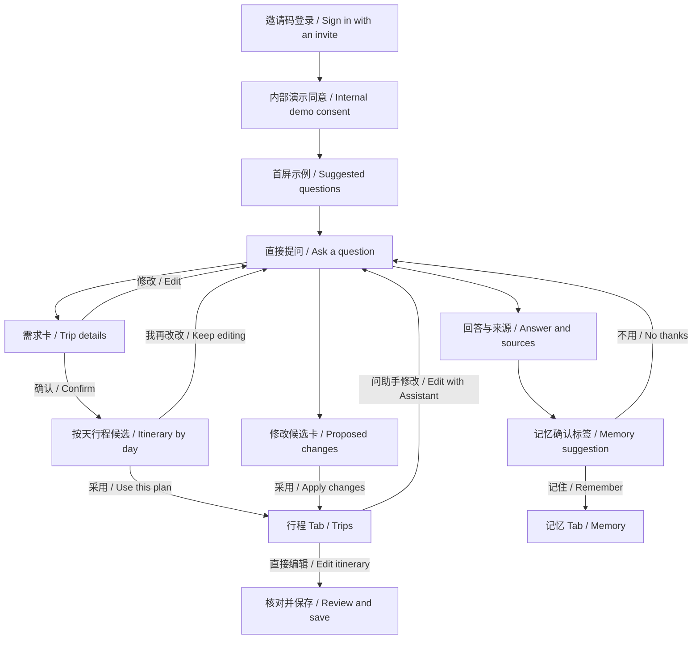

# Muse 风格 UI 规格

## Lio 用户版（#702）

App 对外名称统一为 **Go2China**（JT 2026-11-13）；桌面名称和用户文案使用全名。

以 [JT 的 2026-11-09 决定](https://github.com/JTCAO515/G2C/issues/495#issuecomment-6736601057)及 [#702 修订](https://github.com/JTCAO515/G2C/issues/702#issuecomment-6736604817)为准。Beta 和正式版进入独立的 Lio 外壳；CJShell 的页面、开发 profile 和负例留给 Debug。旧规格保留在附录。

### 助手对话

- 打开就是对话。状态栏与安全区保留；顶部左侧是菜单按钮（图标），中间是 Lio 头像、名字在头像下方（JT 2026-11-11），右侧是「新对话」快捷按钮（D4，只在有对话库时显示，可用条件与菜单里的「新对话」相同，菜单入口保留）。头像使用 [JT 的醒狮头像](../digital-assets/lio/2026-11-09/README.md)。正文在顶部控件和输入框下方滚过，边缘用暖纸底渐隐；不设整条顶栏、欢迎卡或常驻状态行。
- 仅在已知为空的新对话（首次使用或用户明确新建）显示一次普通聊天气泡开场；恢复已有对话、来电/后台返回或重建客户端，不在历史后追加开场。首次历史尚未读到时不先当空对话、不闪出介绍；原消息与草稿继续保留（JT 2026-11-12，#885）。开场文案保持，中文「你好，我是 Lio。告诉我城市、天数和喜好，我帮你排好每天去哪、怎么走。这次想去哪儿？」；英文「Hi, I'm Lio. Tell me the city, how many days you have and what you enjoy, and I'll plan where to go and how to get around each day. Where are you headed?」。新对话同样先显示开场。
- 底部胶囊输入框显示「开始聊天 / Start chatting」，贴合键盘和安全区。首屏显示一排天气、景点、交通、行程小图标和短标签（SF Symbols、D5 配色），大字号可横向滚动。点选只填简短开头（如“天气：”），用户补充后自行发送；开始对话后图标行隐藏，新对话重新显示。中英共用布局和无障碍标识。
- 发送后在回答的位置显示 Lio 小头像和跳动的三点表示等待，读屏朗读「Lio 正在回复… / Lio is replying…」；正文开始显示后三点消失，回答正文逐步显示。发送成功时有一次轻触感。用户版不展示思考步骤、工具动作或供应商来源标签。失败后显示对应提示，不把半句未完成正文作为回答展示。服务数据继续保留原件。
- 用户消息靠右，用 `surfaceSunken` 气泡（右下角收小）。Lio 的开场和回答靠左，每轮开头带小头像和「Lio」，正文放在 `surface` 底、`hairline` 描边的气泡里（靠近头像的一角收小）；JT 2026-11-11 决定回答保留对话框，不用无气泡的纯文本排版（D2 改为此做法）。标题、列表和正文保持可扫读，字号随系统调整；长按消息可复制。用户向上翻看时，输入框上方出现「回到最新 / Jump to latest」按钮，点按回到底部并恢复跟随；开启「减弱动态效果」时不播放动画。可选的记忆确认紧跟相关回答，已保存的行程保留查看入口。
- 菜单中「语言 / Language」下方提供「外观 / Appearance」，可选跟随系统、浅色、深色，选择在重启后保留，并作用于聊天、行程、记忆和弹出页面。
- 悬浮菜单、新对话、回到最新按钮及输入框在 iOS 26 使用原生 Liquid Glass；相邻顶部控件放在同一容器，按钮保持 44pt 触区，输入框不添加按钮式弹跳。iOS 17 使用系统 material；系统要求降低透明度时，两种系统均使用 D5 实色。内容气泡、行程卡和记忆卡保留原表面；减弱动态效果沿用既有规则。
- 配色（D5，JT 2026-11-11 同意，见[重设计规划](design/lio-ui-redesign.md) 3.1）：暖纸底＋朱红主色，浅色/深色各一套，只通过 `LioTheme` 的语义名使用。页面底色 `paper`，卡片和输入框 `surface`，用户消息和次级填充 `surfaceSunken`；正文 `ink`，次要文字 `inkSecondary`；`hairline` 只做装饰性描边，不承载文字。`vermilion` 是唯一的主操作色，朱红底上的文字用 `onVermilion`；`jade` 表示已保存、已记住和固定安排，`gold` 用于记忆相关的图标；发送失败用系统红色。正文类颜色（`ink`、`inkSecondary`、`vermilion`、`jade`、`gold`）在三种底色上、`onVermilion` 在 `vermilion` 上，对比度都不低于 4.5:1，由单测固定。展示级文字用系统衬线（英文 New York，中文回退系统字体），随 Dynamic Type 变化；不使用按需下载的字体。圆角 12（小卡）、20（卡片、气泡）、胶囊（输入框）；卡片不用阴影，用 `hairline` 描边。
- 明确没发出去时，消息旁显示红色感叹号，点按重发同一条；网络中断后的结果核对和续读自动完成。已确认这次没答完才提供「重新问 / Ask again」。当日问题上限由服务端判定。单次请求达到限制时，只说明这次没有答完，不推断整个账号的聊天额度。
- B 的时间线接入前只用本地演示数据，并说明仅提供演示回答；不以演示判定真实工具、额度或公网收发通过。

### 行程、记忆与首次使用

- 记忆确认紧跟对应回答，用金色书签与「记住／不用」操作；辅助功能字号下操作换行。保存成功后在同一位置显示「已记住 / Remembered」，约两秒后淡出；建议变化与保存失败也留在对应位置。没有可核对的消息位置时，恢复中的选择提示保留现有处理。保存、撤销和再次尝试的条件不因样式改变。

- Lio 顺着用户的当前问题回答。身份、能力、酒店或单段交通都可以单独讨论。旅行讨论可以从已有信息和可选建议开始。城市、天数、日期按对话逐步了解，到了需要确定信息的操作再追问缺项。保存成功后，行程卡开头解释安排依据，按天折叠，并显示「已保存到行程 · 查看 / Saved to Trips · View」。行程 Tab 按天呈现时间线，地点用 MapKit。
- 对话里的修改保存成功后直接更新卡片，提供「撤销 / Undo」；行程 Tab 可以查看历史、回到上一份安排，锁定项保持不变。没有保存成功的证据就不显示已保存。
- 记忆只在用户点「记住：……？/ Remember: …?」后保存；记忆 Tab 支持查看、编辑、删除。
- 记忆 Tab 用两列等大的方形卡片，金色类别图标与展示字体；辅助功能字号改单列，每张仍等大，留出完整翻看空间。停用项在卡片右上角只放「已停用 / Deactivated」小标签，不用长句挤占卡片。Beta/正式配置显式消费服务端 V3 短标题；只有成功响应里的 null、空串或空白标题回到原文三行预览，不在 App 内生成摘要。缺字段、错误类型、错误版本或 HTTP 失败均显示失败，不伪装为正文回退成功。完整原文保留在卡片辅助功能值、详情与编辑器；旧 V2 开发读取与所有写入/管理协议不变。点卡片仍进入同一详情与编辑/删除流程，更多记忆与删除记录入口保留；空状态复用 Lio 头像。
- 首次使用先输入邀请码，再明确同意。#225 定案前沿用内部演示文案。只分发内部 TestFlight，正式版不启用演示会话。
- 回前台校验期间再次切后台不等于退出。校验或网络不确定时使用与聊天一致的 Lio 头像、D5 暖纸底和次要文字，提示「正在恢复对话… / Restoring your chat…」，不用独立白底重连页；网络未知时保留登录说明、重试和显式退出入口，不显示邀请码或私密内容；只有明确过期或被拒绝才重新登录。验证通过后用新的已验证客户端回到同一对话和草稿，不自动重发问题；退出、切换账号及注销仍立即清理本机界面并隔离旧回调。
- 短暂的 `inactive`（来电或系统遮挡）保持同一已验证客户端，遮住私密画面并禁用交互，回来后立即按既有规则核验撤销/过期，不重新建会话。真正进入 `background` 仍同步隔离业务客户端，恢复访问须通过原服务校验；退出、撤销与过期边界不放宽（#885）。隐私保护安装在用户场景根部，以非 key 的高层保护窗口和窗口内遮罩同时覆盖根页面、已呈现浮层及切换快照，隔离该场景的读屏与交互；恢复时还原窗口原有 flags，不重建客户端，不改变凭据。
- 内部新版登录与续期采用 B 的新增 7 天协议，仍受邀请资格期限及随时撤销约束。只在有效凭据余期不超过一天时于回前台续期；网络失败保留旧凭据，但恢复访问仍须校验。旧 2 小时凭据继续按旧期限解析，过期不续。
- 页面、无障碍文案和错误提示不得暴露后台操作或内部状态；每个 PR 的静态文案扫描必须为 0。真实服务和无说明 TestFlight 走查分别记为 L2 和 L3。

## Debug 附录：工程界面与历史验收

### 原 Demo v2 · 打开就能问（#702 历史）


以下为原 Demo v2 的历史界面与验收参考，仅用于 Debug；用户版规格见上。邀请码和同意是首次使用的两步；同意后直接进入助手。服务端负责建立并沿用默认旅行上下文。需要更多信息时，在对话里追问。历史会话从助手菜单进入。下文保留的手工选择、原件排查和开发 profile 供 Debug 验收使用。



首次同意文案占位。中文「本次为内部演示。请使用虚构的旅行信息，勿填写个人信息。待 #225 定案后替换。」英文 “This is an internal demo. Please use fictional trip details and leave out personal information. Placeholder pending #225.” 主按钮「同意并继续 / Agree and continue」，次按钮「返回 / Back」。仅确认后进入对话。

首屏保留可直接输入的「问点什么 / Ask anything」输入框。提供四个可编辑示例，点选把原文放进输入框，用户仍明确发送。

| 简体中文 | English |
| --- | --- |
| 在上海怎么坐地铁？ | How do I take the metro in Shanghai? |
| 帮我规划北京三天两晚的旅行。 | Plan a three-day trip to Beijing. |
| 在成都住哪里方便逛老城区？ | Where should I stay to explore Chengdu’s old town? |
| 我旅行时喜欢慢一点，也喜欢安静的酒店。 | I like taking trips slowly and staying in quiet hotels. |

### 对话、行程与记忆

- 「需求 / Trip details」显示日期、城市、人数、节奏与固定安排，缺项标「待确认 / To confirm」。修改回到可编辑内容，确认提交卡片所显示的准确需求。确认前不发起正式规划。
- 「行程建议 / Suggested itinerary」按当地日期折叠。显示时段、地点、来源和锁定项，用「采用 / Use this plan」明确确认所显示版本。「我再改改 / Keep editing」将修改留在对话。只有原回执核实后，行程才显示为正式版本。
- 「修改建议 / Proposed changes」把修改前后相邻呈现，并标出保留的锁定项。「采用 / Apply changes」提交准确差异。行程 Tab 按天显示当前正式版本和可展开的 MapKit 地点地图，可直接编辑或以「问助手修改 / Edit with Assistant」回到对话。时间、来源和未知字段按原记录保留。
- 「记住这个偏好吗？ / Remember this preference?」在对应回答下显示可核对的原文。「记住 / Remember」明确确认，保存状态以原回执为准。「不用 / No thanks」丢弃候选。记忆 Tab 提供查看、编辑、停用和删除，保留现有账号与设置入口。
- 运行状态随对应消息呈现，由服务端 RUN 事件驱动，保留原有顺序和终态，使用「正在查找地点 / Looking up places」等可理解的动作名称。来源引用标签按实际来源编号，例如「来源 1 / Source 1」，点开查看标题、原链接和时间。缺失来源时显示「暂无可核实来源 / No verified source available」。

### 四个 Tab 的视觉与状态规范

| 项 | 规则 |
| --- | --- |
| 颜色 | 使用 iOS 语义色。系统背景承载正文，次级背景承载卡片。用户气泡用淡强调色，助手气泡用次级背景。主按钮用实底及高对比文字，次按钮用轮廓，禁用态保留可读标签。失败和未知用图标与文字同时说明。 |
| 字体 | 使用系统 Dynamic Type。页标题用 title2，卡片标题用 headline，内容与动作用 body，来源与时间用 footnote。中英文按钮允许换行，原回答和来源文字可选。 |
| 间距 | 页边距 16 点，卡片内边距 16 点，组内 8–12 点，卡片间 16 点。使用 12–16 点圆角及至少 44 点触摸目标，保留安全区与键盘避让。 |
| 图标 | 使用 SF Symbols。对话、地图、记忆和操作图标与可读标签配对。展开用箭头，锁定用锁，回执完成用勾，失败或未知用带说明的警示图标。 |
| 空状态 | 助手显示示例和输入框。行程显示「还没有已采用的行程 / No saved trips yet」，并可去助手规划。记忆显示「还没有已保存的记忆 / No saved memories yet」，并说明可在对话中确认保存。插件保留真实可用性提示。 |
| 加载 | 原消息保留可见。只读页面的实际请求可显示系统进度；消息下的工具进度只在收到对应服务端事件后显示。正在核对原动作时关闭重复确认按钮。 |
| 网络失败 | 「网络暂不可用，请检查连接 / You’re offline. Check your connection.」保留草稿。已发出但无明确结果时引导查询原动作。 |
| 每日额度 | 服务端明确拒绝后显示「今天的 40 个问题已用完，明天再试 / You’ve used today’s 40 questions. Try again tomorrow.」已有内容继续可读。 |
| 结果未知 | 「暂时无法确认结果，查看原操作 / We can’t confirm the result yet. Check the original action.」仅核对同一动作，保留已收到正文和原输入。 |
| 其他失败 | 「暂时无法完成，请稍后再试 / We couldn’t complete this. Try again later.」明确拒绝与结果未知分别显示；涉及写入先保留原回执和可恢复入口。 |

两种语言共享布局和无障碍标识。按原件核对中英操作、长文字、键盘、来源、折叠状态和完整 AX 自动审计。真实服务和 TestFlight 体验分别在 #702 L2 和 L3 记录。

## 助手页面

```text
系统状态区域（保留安全区）
  ≋ 左双横线       角色头像 + 名字        礼物
       三组各自悬浮，正文可延伸到顶部

  可滚动对话正文、来源、草稿、记忆回执/确认气泡

  [ +        开始聊天               语音 / 发送 ]

  助手          行程          插件          记忆
```

示意不规定像素或最终角色图。不再使用整条 App 背景顶栏、独立快捷行、大欢迎卡或独立状态行。空态从对话起步；运行/工具/记忆状态在相关正文、气泡或操作位置表达，不另造常驻状态行。

顶部三组控件各自悬浮：左双横线、中角色头像与名字、右礼物。正文延伸顶部但有效内容仍可滚动到无遮挡区域。浅色、克制配色，局部轻透明渐变帮助可读性与遮挡管理；不用大面积装饰或重色背景。顶部/底部覆盖层的触摸范围不阻断正文链接、文字选择和滚动。

胶囊输入默认文案“开始聊天”，左加号、右语音/发送状态。非空文本显示发送，发送中/失败/不可用要可感知；停止生成与恢复可在相应消息操作中表达。附件、语音、礼物/referral 仅视觉入口，实际未开放时明确双语说明，不启动录音、上传、付费、邀请或外联。具体去向待定。

## 导航与页面状态

四 Tab 使用图标和短标签，顺序固定为助手 / 行程 / 插件 / 记忆（英文候选 Assistant / Trips / Plugins / Memory，最终文案随双语核对）。插件页说明尚未开放，并以不可操作的占位卡展示下一版方向（首个为滴滴打车）；不显示虚假的可用工具。记忆内放账号/设置/语言/退出/注销；角色悬浮入口的导航行为由 UI 契约明确，不把账号移出记忆。

行程页展示当前正式版本、每日安排/地图、地点中文名及英文说明、来源/待核实项、同步/离线时间与选定修改范围。手动保存可直接表示确认；AI 草稿接受/拒绝与扩大修改范围须可审阅。接受不等于所有事实已核实。

助手用带角色标识的气泡呈现原消息和正文，用独立卡片呈现会话上下文、规划候选和投递回执。读取、选择、采用、查询和反馈使用带图标和文字的按钮，发送受限时在输入旁说明原因。行程列表用卡片按钮区分版本和选中状态，当前行程、修改、前后差异与原动作分组呈现。确认采用和保存使用醒目的主按钮，未就绪时保持禁用，说明和原始记录继续可读。

记忆列表、详情、编辑/启停/删除、保存回执与归纳确认气泡按[记忆规格](memory.md)实现。失败、未知、清理中不能用乐观成功提示盖过。登录失效、账号切换与断网时分别呈现可恢复操作，不展示另一账号的晚到内容。

### 本地记忆接线（#228）

本地 `current` 范围沿用 MESSAGE 会话语义。保存选项显示“当前会话”及完整原 `context_id`，多个会话分别可辨；详情展示同一会话标识。旅行范围已由 #227 冻结；当前本地 V1 入口保留会话语义，typed 接线与实测由 #228 框4承担，不将会话称为本次旅行。

显式 DEBUG 模拟器会话可通过已验证的本地账号与 #226 API 保存事实、经历、偏好；Release、真机或未配置环境不启用该调试入口。可跳过的 2–3 问按获准类型区分，仅用户点击保存才提交，不从跳过或未确认内容制造长期事实。

服务端明确 `failed` 的原操作保留加密原字节，并独立保存拒绝状态；重开后查询原回执为 null 时仍显示明确失败，可由用户发起另一条新保存。缺少明确失败记录的 null 仍为未知，不授权重发。

新增表单与原操作恢复分开显示；提交后以只读内容和实际状态展示本次原文，不提供重发入口。新保存先查询已有原回执，未观察到回执时保持未知并阻止新写入。重开、语言切换与身份变化沿用原 ID、原字节和当前会话隔离；历史保存回执不表示下一次回答已经使用该记忆。#227 当前上下文消费仍需独立验收，进度与证据见 #228/#12。

## 适配与验收

| 场景 | 必须观察的行为 |
|---|---|
| 系统状态栏/安全区 | 顶部正文和悬浮控件可读可点，状态栏正常；不同屏幕尺寸不遮住首末消息 |
| 键盘/焦点 | 输入与发送可用，正文末端可见，关闭/切换键盘和 Tab 后位置合理；无双重底部留白 |
| 长回答/中英混排 | 滚动、列表/链接/文字选择稳定，中文地点不被英文布局截断；不因流更新重复正文 |
| 默认字号/完整 AX | 控件有标签和状态、阅读顺序合理、对比与触摸范围可用；不用颜色作为唯一反馈 |
| 状态组合 | 空态、加载、流式、取消、失败、未知、离线、记忆保存/清理均能理解；无整条状态行复活 |
| 资源未定 | 中性占位头像/名字可验证布局，不沿用 VisePanda/旧川剧熊猫为当前品牌 |

双语功能/错误/帮助/隐私与无障碍均需检查，先模块/模拟器验证，最终真机完成核心旅行和完整记忆链。此文没有设计稿像素值、可用性测试或性能测试结果；当前均未运行。

## 内测帮助、隐私与支持（#159）

记忆页提供帮助、隐私说明（内测版）和支持入口。文案依据 #159 的 JT 双语确认及服务主体确认：Context Jump LLC，广州创竞科技提供本地支持；唯一支持邮箱为 `hello@go2china.space`。邮件链接仅打开用户邮件应用，不代发、不确认送达。方案页展示 Early Access 与价格待公布，不展示旧价格、不提供购买或授予权益。外部服务及未交付的数据控制明确标注当前未开放；正式政策律师审阅仍属于 #34。

### 本地记忆管理（#271）

已读取的条目提供显式编辑、暂停/恢复与停止使用。编辑仅更正文，范围、对象、字段、类型、原始时间及来源权限由服务端保持；停用状态下编辑不会自动恢复，候选或推断不提供编辑提升入口。提交后原输入保持只读，成功回执提示用户刷新条目查看当前状态。停止使用会保留原记录与历史，不能称为物理删除。

“此前的记忆操作”使用独立页面，只读取加密原日志并查询原 ID。明确失败保留输入与失败记录，重新读取并审阅后才能提交新动作；未知或 null 仅允许对账，回执读取失败也不能冒充原写入失败。历史回执不刷新来源资格，账号切换后旧请求结果不能进入新账号页面。状态随中英设置渲染，原文与来源标识不翻译或规范化。

该入口只在显式配置管理地址的 DEBUG 模拟器会话启用，和主本地 API 共享已验证账号生命周期；Release、真机与未配置环境继续维持关闭状态。运行中的既有有效片段不因后续暂停而被追溯删除，后续失效结果须明确显示为上下文失效/部分正文，不能显示为新完成的有效回答。

### 本地 PLACE 引用卡（#266）

显式配置 `G2C_DEV_PLACE_TOOLS=synthetic-v1` 的 DEBUG 模拟器会话，可把原 RUN 中冻结的 `TOOL-output.1` / `TOOL-answer.1` 渲染为只读资料卡。它只消费受保护的原快照/流，不派发额外地点请求、不自动重试、不接受 TripProposal。未配置时保留原回答格式；未知帧或畸形结果在该模式下显示不可用，不降级成普通文本或空结果。

地点中文原名、地址和 provider ID 保留原文，同名分店分别显示中心、入口与出口角色。缺失、空列表、空字符串、空值、无效与未知保持区别，不补零坐标、不借用另一分店或建筑中心。官方英文名称/地址没有依据时显示未知；双语机器说明明确标记为非官方。路线保留原起终点及其角色、方式、距离/时长单位、请求出发条件和来源原时间，查询时估计不表示未来保证。

资料始终标记为本地合成来源，和真实供应商证据区分。只展示完整帧；接收中、未完成帧、取消、限额拒绝和未知状态由原 RUN 状态继续约束，历史读回不得变成重发。账号、原消息、会话或显示生命期变化后丢弃旧结果。此入口不转换坐标、不申请定位权限，也不代表地图/导航、真实供应商或现场点位已验收。

原生验证入口为 `ios/App/Acceptance/check_places.py`，要求显式 `CJ-LOCAL-RUN@2` 配置、实际签名本地 API、私有 PG、正式 `run_once`、固定 synthetic-v1 工具与 FakeProvider；检查真实工具调用、原结果恢复和受限角色。完整 L1 进度只回写 #266，不能用模块样例代替。

### Typed Memory 与旅行上下文（#228 框4，验收中）

仅 DEBUG 模拟器可显式配置该模式，以下三项必须同时存在，缺失或畸形即拒绝接线，不回退旧写入入口：

- `G2C_DEV_TRAVEL_PROFILE`：`{"version":"app-travel.1","travel_ids":["<B实际创建的32位ID>"]}`，允许空候选列表，但发送前仍须明确选择“不绑定旅行”。候选 ID 只是可选项，选择旅行后必须读取 B 的 owned/active/version；不推断默认旅行。
- `G2C_DEV_TYPED_MEMORY_PROFILE`：`{"version":"app-memory.2","subjects":["self"],"slots":{"preference":{"kind":"preference","collection_allowed":true,"semantic_resolved":true}},"extents":["long_term","current"]}`。这里只定义界面选项；服务端独立集合策略和 B 许可继续裁决。旧 `context_ids` 不得重解释为旅行同意。
- `G2C_DEV_TYPED_MEMORY_URL`：显式 `http://127.0.0.1:<port>`，连接冻结的独立 typed Memory 本地 host。它不替换主 API 的环境/账号分区。此前管理动作只通过原 `G2C_DEV_MEMORY_MANAGEMENT_URL` 的明确入口查询，不试用另一版本或地址绕过失败。

保存前显示固定的原文、对象、字段、时间和实际范围，确认后以同一原输入提交；修改也显示原条目/来源版本及实际核实的旅行版本。原会话范围保持原义，不冒充旅行。推断保持候选，停止使用保留历史/来源。读取失败、空结果、已保存、拒绝、UNKNOWN、未观察到原回执及“此前操作需先查询、本次未新增提交”分别呈现。

V1/V2 手动与管理日志各自保留原 ID/字节和加密域。旧 UNKNOWN 未核实前不能换版本新增提交；原操作只读查询可继续。typed 恢复页从原动作显示只读编辑文字，不用当前条目覆盖被拒绝或未知的原输入。已核实的历史回执跨页面保留，但不是当前条目状态或新派发权。丢失本地键且同账号任何相关日志仍有数据时，拒绝生成替代键。账号/页面退出撤销旧显示与新提交，迟到回包不得发布到后继页面。Release、真机和未配置根入口保持关闭。

RUN 按原消息的不可变关联选择原快照/草稿/取消格式，不因失败改版本重试；typed 原结果使用冻结快照 GET，不制造尚未冻结的 typed SSE。历史读取的受支持新增版本仍见 B #327。当前代码/构建/模块检查不等于框4 L1，完整签名 API/私有 PG/正式 worker/FakeProvider 原生证据及红线审查/精确 CI/合并仍需另行回写。

同账号一旦建立 typed 日志命名空间，移除新配置只会让旧入口保留 V1 只读查询，不能重新取得 V1 保存/管理能力；即使历史回执已核实，也不自动授权不兼容的旧写入器。目录不可核实时同样拒绝旧写入。处理原操作和新增内容应恢复兼容的 typed 组合，不删除日志或更换加密键来解锁旧写入；尚未启用 typed 的旧账号路径保持原行为。

### typed Memory 可选问题与已读页分组（#332）

typed 入口提供2–3条可跳过的问题，只从当前配置已允许的对象、slot、kind及范围生成选择；只有一个可写字段时，第二问为可跳过的补充回答，表单仍需明确选择获准范围，不新增 writer。推断不因问题入口升级为事实或已确认。浏览、下一问和跳过均不提交；每条回答复用原 manual.2 表单、原内容/对象/字段/时间/实际旅行版本核对及一次明确保存。旧 UNKNOWN 必须先核原动作，跳过不取消或重发。已有同对象/字段/范围的 active 条目仍受原 canonical-slot 约束；应在列表核对原条目后明确编辑，不以新 ID 绕过冲突。

列表按实际读取到的 kind 分为事实、经历、偏好及待确认推断，明确标记“已读取页面”，不显示全量计数；尚未读到某类不代表账号没有该类内容。使用冻结 V2 的原 after 游标继续分页，读到空尾页才结束本次遍历；不是跨页一致性快照或全量统计。空、失败、当前条目与历史回执保持原有区别，账号/页面退出仍撤销旧结果，迟到回包不得进入后继账号。Release/真机及未配置 typed 根入口保持关闭。真实服务/费用与设备仍由 #32/#29 承接。

### 合成 FACT 只读引用

`G2C_DEV_FACT_TOOLS=synthetic-fact-v1` 显式开发配置消费冻结的 `FACT-output.1` / `FACT-answer.1`，与 PLACE 展示配置互斥；缺配置仍用普通回答，冲突/畸形配置拒绝激活，Release/真机不启用本地权限。来源、关联 hash 和引用卡不会授予新调用、Memory 保存或 Trip 确认能力。

卡片始终标明 synthetic/合成、非真实天气或资格结论。原 JSON 标量（含否定、币种、日期）、来源 URL、检索/发布/失效时点及原 offset/fold、声明地域/含起止日范围/条件保持可读；机器适用性说明不能标成官方翻译。解码器重读原始来源字节并核对摘要、Unicode 区间、声明、适用性和原 RUN 关联，不信任单独的状态标签或 hash。

超范围、过期、冲突、信息不足、无来源、限流和无效来源分别呈现。卡片只表示原评估时点，不随设备时区或重开刷新有效期；读取失败不改成空结果或成功，不把未结束帧显示为完整结果。取消/超限/UNKNOWN 沿用原 RUN 与原操作只读恢复，不自动重发；账号/显示生命期变化丢弃迟到引用。真实来源/模型/费用在 L2 #32，真机在 L3 #29 验证。

### 本地需求预览与手工纠正（#320）

仅显式 DEBUG 模拟器配置 `G2C_DEV_NEEDS_PROFILE=manual-v1` 与 `G2C_DEV_NEEDS_ID=<明确选定的记录ID>` 后启用本地需求手工入口。`G2C_DEV_NEEDS_PREVIEW=synthetic-needs-v1` 单独选择冻结的未确认提取展示，与 PLACE / FACT 展示模式互斥。普通构造、Release 和真机不取得该调试写入能力；服务端仍从签名身份确定 owner，不使用客户端记录 ID、hash 或来源标签授权。

NEEDS-PREVIEW@1 必须属于当前已接受原消息与原 RUN；核对的是实际原用户文本 UTF8 字节及其 SHA256，不是整个 MESSAGE 命令的 hash。未确认候选、缺条件追问、原消息和“长期请求未写入记忆”分开显示。预览不产生需求、Memory 或 Trip 写入；只有用户明确选择编辑基准、复制/纠正并保存，才冻结一次手工命令。读取最新记录保留旧编辑和原 `expected_version`，换用最新基准须再次明确选择。

人数与同伴、本人/全体/具体同伴、本次临时条件与长期请求分别保留。币种、总计/每人、已付和包含/不包含国际交通范围各自显示，不换算、相减或补零。切换币种不会重标已有或复制的金额；未逐项重新输入或明确标记未知前不允许保存。抵离/固定事项保留明确当地日期、时间和 IANA 时区，不按设备时区转换，不把预订声称或固定意图当作已核实订单。

提交前持久保存加密原 ID/字节。UNKNOWN、未观察到回执、格式错误及读取失败都不允许换 ID 新写入或自动重发。明确的原 POST `failed/do_not_retry` 以独立加密拒绝记录保留，原命令不覆盖；空 GET 不能单独制造失败证据。只有原回执和确切历史修订的原始字节一致后，才可由用户明确重放同一原动作。核对同账号其他记录的原动作不改当前编辑目标/版本。停止等待不声称撤销服务端提交，仍核对原动作；账号/会话变化丢弃迟到内容。

字段标签和值关联为完整无障碍行，原值仍可选择；表单提供键盘收起入口，关闭键盘不关闭需求面板。原生验证入口 `ios/App/Acceptance/check_needs.py` 仅用实际模拟器、签名本地 API、全新私有 PG、正式 `run_once`、显式 @2 配置与 FakeProvider。记录所有 PASS/FAIL/UNRUN；真实模型/账号/外部服务/费用/云转 L2 #32，真机转 L3 #29。

编辑器与已读记录详情一次展开一个，避免把未保存条件与已读版本混在同一长表单中；折叠不清空编辑、不修改版本基准或原动作。选择“未记录”表示省略该字段修改，服务端保留原值，因此不能用来绕过换币种时的旧金额复核。

### 正式行程当地时间线（#21）

从行程页明确打开当地时间线，按冻结的 `TRIP-structured-read.1` 发现并读取已经采用的 `structured.1/.2` 记录。列表、详情和时间线使用同一原账号／会话，选择新记录前不保留上一份详情，读取失败不改成空结果。

时间线按原开始日期与 IANA 时区分组，同组保留已采用顺序；分钟精度不补秒，缺失、未知与不确定值不从设备补齐。跨日条目只在声明的开始日显示一次，并明确显示结束日期；两端时区不同时保留各自声明，不推断日期位移或时长。分组不写回正式行程，也不证明整体可行性。地图与真实点位验证仍按其独立契约和验证层推进，不把时间线当作地图验收。

助手消费准备固定为冻结的 `MESSAGE-send.3` 讨论语义，独立于旧发送能力：明确 Trip 当前读取版本、日期／时区和条目，或明确不绑定；不接受从正文解析出的 ID，不自动选择最近行程，不取得 Proposal 或 Trip 写入权限。时间线交接保留实际受保护读取的生命周期；未知日程只能选择整个 Trip 或已知条目，不能补成设备日期。新读取选择、账号变化与 A→B→A 均使旧入口失效。

原消息字节和原回执中的选区 epoch、正式内容版本／hash 一起保留。新 RUN 读取、草稿状态和取消回包必须与该完整原引用一致，不把回包里的新版本换入原动作。当前进程从实际 Trip 读取交接的内容版本／hash 也须与接收回执一致；它们不进入 send.3 命令，不作为客户端许可。丢 ACK 后先核对原消息；恢复确认不能绕过原动作查询，也不自动重发。send.3 的已有 MEMORY scope 升级拒绝仍保留，不关闭记忆或伪装绑定成功。

本地 DEBUG 模拟器仅以 `G2C_DEV_MESSAGE_PROFILE=trip-discussion-v1` 显式接入该讨论入口；普通旧模式与 Release 不取得新发送能力，typed-memory 旧旅行组合不能被此配置静默替换。历史使用 `MESSAGE-history.2` 保留各代原字节／引用，显示文本不创建本地原动作。`ios/App/Acceptance/check_trip_discussions.py` 验证不绑定澄清、真实 MEMORY 升级拒绝及正式 Trip／日期／条目讨论。正式来源经实际带 NEEDS 引用的 MESSAGE-send.2、原 worker/FakeProvider、原确认采用，再由 C 的 TRIP-source-initialize.1 显式初始化既有行程，不注入 Trip。合成日程明确标为 synthetic；旧生产者的条目与 NEEDS 对应关系仍是 UNKNOWN，不据此取得手工编辑或规划来源权限。地图实际 SDK／点位、真实服务和真机仍按 L2/L3 单独验证。

拒绝／不可用提示保留原消息核对入口，不把 `outcome=unknown` 解释为确定未接受或未建立绑定。App 不以关闭已有记忆来绕过讨论模式的兼容限制。

新讨论聊天使用现有 `openConversation` 幂等接口和一次生成的原 ID，不重新激活关闭的聊天。创建前持久记录该 ID；新草稿为空，原会话草稿仍留在原 ID 下，不把旧旅行的临时文字搬到新聊天。未归属会话的草稿需要先选择会话或清空。创建结果 UNKNOWN 时只核对原 ID，空读取不放行另建；核对动作本身不切换当前会话或替换编辑内容，选择已读聊天仍需明确操作。

新增本地加密快照版本 2 保存聊天创建记录，旧版本 1 的字段与读写仍保留；旧二进制拒绝版本 2，避免丢弃未知创建后另造 ID。新二进制保留旧消息、草稿与原动作恢复，读取本地可用记录不授发送许可，仍需同账号／会话的新聊天头读取。时间线讨论按钮同时固定所显示读取的上下文；刷新或相同 ID 的重新读取后，旧按钮不能静默切到新版本。


### 正式行程地图（#21，JT 2026-11-02 MapKit 授权）

地图仅消费正式结构化 Trip 的 `sources[kind=place]` 原快照；文本和标记共享原 provider ID、名称、中文地址、坐标字符串及来源 hash。只有明确 GCJ-02 坐标产生标记，不转换坐标；其他 CRS、UNKNOWN、无来源和估算路线不补点，原始字符串保持不变。地图底图不构成真实点位对齐证据，该项继续由 #32/#29 承接。

Apple MapKit 无 API Key、无高德 SDK、无新增第三方依赖。用户明确展开地图后才加载底图；不申请定位权限、不显示用户位置、不添加定位用途声明。加载失败只影响地图，来源文字和正式时间线保留。MapKit 会把查看区域发送给 Apple，此数据流已通知 #34/#225 纳入隐私说明和合规评估；没有宣称隐私/合规或真实点位验收 PASS。使用系统 [MKMapSnapshotter](https://developer.apple.com/documentation/mapkit/mkmapsnapshotter) 生成受控只读地图，完整显示 SDK 图像及其归属信息，不裁切或持久化底图；标记位置通过 MapKit 原生 point(for:) 投影，不实现 CRS 转换。标记、缩放和 Apple 法律信息提供44点可访问控件，原机器标识/坐标放在可访问值中，名称作可读标签。载入错误清楚呈现；DEBUG 模拟器的验收故障注入只测试同一失败处理分支，不冒称真实网络故障，Release 不启用。

### 明确选区的局部请求前缀（#337）

DEBUG 模拟器可显式选择 `G2C_DEV_MESSAGE_PROFILE=trip-edit-v1`，消费冻结的 MESSAGE-send.4、message-trip.2 与 RUN-display.4 / draft-status.5 / cancel.4。此模式必须同时配置实际 typed-memory、独立 TRAVEL 选择和已保存 NEEDS 读取；不会升级旧讨论模式、沿用 Trip ID 作为记忆 namespace，或在缺少来源时退成仅长期记忆。

行程时间线的实际读取交接到助手后，用户分别明确选择独立旅行记忆上下文、已读取的已保存需求，以及“仅讨论”或“请求局部候选”。日期与条目二选一用于候选；整个 Trip 选择可讨论，不能用来扩大修改范围。更换行程/选区清空先前 namespace 和需求选择。控件固定所显示的来源生命期，旧按钮或过期需求不能静默指向新对象；中英切换保持同一原选择和请求字节。生成本身不接受候选或改变正式 Trip。

本前缀只提供原请求生成与原消息/RUN的严格读取、恢复和取消。原引用完整核对选区 epoch、Trip/version/hash、解析条目、namespace 和 NEEDS；新版本历史保留各代原字节及引用，不创建本地写入许可。UNKNOWN/空查询不另造 ID 或自动重发。明确的原 POST failed/do_not_retry 保留原字节与拒绝证明，新请求仍需读取当前会话；INPUT_CONFLICT 保留完整性拒绝。

本地加密快照版本3仅在保存原 POST 拒绝证据时使用，原1/2格式与数据保留；旧二进制拒绝3，不能丢弃证明后重发。拒绝证明与原动作状态一次原子保存，GET不能制造POST失败证明，存储未知仍按原动作恢复。

候选发现使用 C #366 已冻结的 `TRIP-scoped-discovery.1`，只携带原回执的 message/run，不猜 proposal 前缀或解析模型 request_id；published 本身不构成接受许可。原生验收脚本用实际 App、签名本地 API、受限私有 PG、原 run_once/Meter、显式配置与 FakeProvider 核对，worker Outcome 仅作后端断言，不传入 App。扩域/澄清的非可接受持久结果仍按 B #360/C #336 的实际冻结交付消费；真实来源、模型、服务、费用、云和设备按 L2/L3 单独验证。

### 原消息的局部候选（#337）

候选面板使用原 MESSAGE 回执的 message/run 读取受保护的候选发现，显示原版本、修改前后、固定状态、当地时间和原可行性/缺失依据；UNKNOWN 不改成已核实。读取失败仅允许再次读取原记录，不创建 action 或重调模型。

用户明确接受或拒绝这份确切候选后，先加密保存原 action ID、字节和候选响应，再发送一次。重启通过“此前局部动作”查询原回执；null/断网保持 UNKNOWN，没有重发入口。正式保存的回执与当前 Trip 读回分别显示，读回不可用不抹去已核实的回执。账号和原消息选择变化使旧读取失效，中英切换保留同一候选。扩域/澄清结果不显示为可接受候选，地图保持原未连接状态。

### 原消息的澄清与扩域结果（#337）

仅 DEBUG 模拟器显式配置 `G2C_DEV_MESSAGE_PROFILE=trip-edit-result-v1` 时消费 B #360 的 RUN-display.5、RUN-draft-status.6、MESSAGE-send-status.5 与 MESSAGE-history.4。发送仍用原 MESSAGE-send.4，取消仍用 RUN-cancel.4；旧 `trip-edit-v1` 和 Release 默认路径不变。此模式要求与旧局部模式相同的 typed Memory、独立旅行选择和已保存需求，并拒绝环境 proposal ID。服务端还须由 operator 显式激活冻结的 `message-edit-result.1`，App 配置不授予运行权限。

App 核对原 message/run/input hash 和完整 MESSAGE-edit-reference，再核对 RUN display 与 draft 的同一个 `RUN-scoped-result.1` 指针。只用指针中的原 result_id GET 受保护 `TRIP-scoped-display.1`，不从模型正文、worker Outcome 或命名前缀猜结果。新 outcome 只有完成状态和正确指针才可读取；历史普通 outcome 必须没有指针。原 MESSAGE-accept.4 加密字节保留，重启重新读取原 RUN，不改写旧回执格式。

澄清显示未知日期、跨日条目、未匹配日期与原因；扩域显示越界条目/日期、具体 before/after、所需范围和原可行性报告。UNKNOWN、missing 与未通过输出检查不冒充可接受候选。中英只切换原结果对应的语言文字，不重新规划。结果不提供接受或拒绝写入；“保留原行程”只是本地展示选择，零 Trip action。整份标题变化不能由局部条目选区授权，须保留或明确使用手动标题编辑。

用户可重新读取当前正式行程，逐个明确选择不同日期的条目，再点击使用选区；初始不勾选结果建议，更换读取或刷新清空尚未提交的勾选。多个条目复用同一正式读取和账号生命期，只传该记录真实存在的原 ID、version/hash，不补齐日期或复制条目。新范围仍需重新明确 namespace、需求和修改意图并发送新请求；结果展示不会自动复制范围、发送消息或创建 action。旧讨论模式拒绝多条目专用选择，不能静默退成整份 Trip 讨论。

读取失败清除先前正文并显示不可用，不制造新 MESSAGE、模型调用或 Trip action。账号/原消息/会话变化使在途及已读结果失效。Trip 版本变化只展示 stale 和原/当前版本，不保留旧原因或建议范围。实际签名本地 API、受限 PG、原 worker/Fake 与模拟器证据分场保存；真实服务/费用/云/生产及真机仍分别由 L2/L3 验证。

### 本地正式行程手动编辑（#286）

仅 DEBUG 模拟器显式选择 `G2C_DEV_TRIP_MANUAL_PROFILE=manual-v1` 时启用正式结构化列表、详情及手动编辑；NEEDS-bound 行程还须读取明确选定的需求。用户选择标题、条目文字、明确起止观察或固定状态，准备后查看原 before/after diff，点击保存就是对这份改动的确认。固定状态与文字／时间修改分开提交，未选中内容、原 ID 和未知观察不补齐；原需求的固定约束仍由服务端核实。

读取当前版本保留输入；替换基准须用户明确操作。失败、冲突与 UNKNOWN 分别显示，读取相同内容或更新版本不能冒充原 save 成功。原准备／保存字节先进入账号与环境隔离的加密日志，重启后只查询原 ID，不自动重发；缺键且已有日志时拒绝生成替代键。历史回执不授予新写入权限。账号／页面退出使旧结果失效，迟到回包不得覆盖新上下文。

Trip-local 固定／取消固定只改变正式 Trip，不改写 NEEDS。完整后续重新规划还需正式 `TRIP-source-input.2` 生产入口；创建用 `source-input.1` 和局部 send.4 不替代这项组合。地图及真实服务／设备仍按各自验收记录，不由本地编辑入口启用。

### 本地 NEEDS 规划发送前缀（#373）

仅 DEBUG 模拟器显式选择 `G2C_DEV_MESSAGE_PROFILE=needs-planning-v1` 时组装独立旅行选择和已保存 NEEDS 的 MESSAGE-send.2 规划入口；同时要求明确的 `app-travel.1` 选择列表、`manual-v1` 需求记录配置及普通回答格式。typed Memory 配置、工具回答或旧环境 proposal ID 与该模式不兼容，旧模式的部分配置拒绝规则保持。

用户明确开启“规划行程”，读取保存的旅行需求并选择服务端核实的旅行上下文后才可派发。未读需求、无上下文或失效的选择不能派发，不回退到其他旅行或本地草稿。复用原 MESSAGE 加密日志、原 UUID/字节/hash、回执、RUN 与只读恢复；中英切换不重发消息或重调模型。

RUN 的 published 仅说明已记录候选，不代表正式 Trip。此发送前缀不从正文、worker Outcome、命名前缀或环境 ID 查找候选，也不走旧 provenance/action 降级。受保护 NEEDS 规划发现/采用仍按 C 实际冻结交付接入；source2 后续规划区分来源 context Trip 与新规划 Trip，不冒称原地手改，正式组合另验。

C 的 `TRIP-needs-discovery.1` 已接入该模式：从原 accepted MESSAGE 的完整 travel reference/NEEDS 与 message_id/run_id 查找候选，保留 opaque candidate hash；候选快照、来源 context Trip 与新规划 Trip 分别展示。采用／拒绝只确认当前这份已读候选，原 action 字节先进入独立加密域，再一次 POST；未知不重发，重启只核原 receipt。采用按原 receipt 的新 Trip ID 读回，拒绝要求 committed_version=null。GET null 保持 UNKNOWN 或已记录的原明确拒绝，不凭同内容或竞争方版本冒成功。正式 source2 重新规划入口与整票组合仍另验。

### 注销入口与范围说明（#27）

记忆根页和账号页均提供“注销账号”入口，不依赖记忆列表是否为空。
双语说明区分单条记忆删除、本机退出与全账号注销，区分停止使用和清理进度；
说明14天离线期限、重连失效清理、30天滚动备份及外部副本边界。
正式注销操作未接入时明确显示尚未开放、未发送请求；阅读说明不创建操作或清理文件。
此入口不代替 #27 的 CLEANUP 接线、原操作进度及设备文件物理清理验收。

### 正式行程离线读取（#24）

显式本地开发配置 `G2C_DEV_OFFLINE_TRIP=last-sync-v1` 在行程页提供离线入口。
“同步用于离线读取”只做正式行程受保护 GET，原始响应成功保存并核验后才显示同步成功。
离线页显示同一快照的版本、同步时刻和截止时刻；中英只切标签，不翻译或重建原内容。
页面只读取本机缓存，不发送或排队业务写入，不加载地图，也不声称最新路况或营业时间。
到期、时间回拨/不可信、身份不符或缺少安全锚时明确拒读；成功联网同步才重新起算14天。
退出/换号先阻断，再清理确切本机文件。重连的503、网络失败和UNKNOWN不清理、不续期，只有服务端明确拒绝身份才触发本机失效清理。
离线读取本身不创建原注销操作或设备回执，不声称其他离线设备已清空。
原注销/设备链消费 B 已提供的 CLEANUP-API@1 / DEVICE@3，由 #450 单独验收；未以接口到达代替通过。

### 回答与记忆页反馈（#15 / #430）

显式 DEBUG 模拟器配置 `G2C_DEV_FEEDBACK_PROFILE=feedback-v1` 接通 FEEDBACK@1.0。
实际回答入口绑定当前已接受 message/run 的原回执和同一 SDK 会话；关联默认关闭，用户开启才发送引用。
记忆根页提供独立通用反馈，仅提交自愿填写的问题和期望，refs为空，不把记忆标识冒充已支持来源。
提交前加密持久化原 UUID/UTF8 字节；UNKNOWN、丢失回执或重开只查询原动作，null不解释为未提交。
两入口互不覆盖草稿，账号/来源切换屏蔽旧结果，中英提示不改变原内容；成功仅表示反馈已提交。
全部原动作核验成功后，用户可明确点击“反馈另一个问题”；不自动重发，也不复制消息全文。
原始来源观察与当前运行状态分开，未提供的模型/规则版本、工具结果和用量不补造；不声称已修复或已训练。

### 按会话的历史整理授权（#23 / #434）

显式 DEBUG 模拟器配置 `G2C_DEV_MEMORY_HISTORY_PROFILE=history-v1` 只在已验证的账号根接通。
记忆页的“会话历史整理”针对助手服务器历史里当前选择的真实会话，不从 ShellContext 或环境变量猜会话。
每段会话默认关闭；保存单条记忆、在聊天里说启用全部历史，都不授予全部历史权限。
只有受保护 settings GET 成功后才展示当前开关。失败、缺schema、503或未核实不会画成“已关闭”。
启停是明确用户动作，绑定读到的generation/epoch/source_version；原UUID/7键UTF8/hash先加密持久化。
UNKNOWN/null只核原GET，不自动重发或换ID。冲突重新读取并核对后再明确操作，原记录保留。
历史回执不代表当前开关；查询或提交成功后另读当前settings，读取失败不冒充原动作失败或当前已启用。
停用停止新来源整理，已确认记忆仍须单独管理/删除；允许整理不等于已处理/已记住，推断仍要用户确认。
候选气泡消费C已交付的V5真实job/attempt发现关联，不用fixture或环境任务ID冒充实际来源；App剩余组合见下节。

### 候选记忆逐条核对（#23 / #460）

记忆根页提供“记忆建议”入口，空记忆状态也能找到。尚未绑定当前账号和助手真实已选会话时，明确显示不可用，不发起核对操作。
已绑定消费者从受保护的V5接口发现真实producer，再读取该producer的V3当前候选；不以模型输出或历史回执充当当前状态。
建议气泡显示原内容、主题、时间、范围及当前状态。用户打开一条建议后，可以编辑内容和时间，再明确确认或拒绝。
推断候选不默认转成偏好，必须明确选择事实、经历或偏好；原长期/行程范围与Travel身份不由编辑框改写。
确认只针对这一条，不等于历史整理授权。新读取、换会话或换账号后，旧编辑框不能转投新候选，中英切换保留同一原内容。
原请求先加密持久化再提交一次；UNKNOWN、null和重开只允许查询原动作。历史成功与当前状态分开，当前读取失败不显示为“没有建议”。
本切片提供页面、Shell宿主和正式HTTP消费者，尚未在App Root创建候选日志目录或启用此工厂；B追加设备清理版本/共享键核空范围及实际原生组合仍待交付，#460和父票App框保持未完成。

### 原注销与本机清理（#450，验收中）

显式本地开发 account/offline 配置另加 `G2C_DEV_CLEANUP_PROFILE=device-v3`，
才在既有注销入口连接原操作准备、本人确认、原受限进度和本机结果；Release/未配置仍关闭。
读取原 prepared 操作后确认入口保留；确认未知只能查原操作，不创建替代操作。
本机停止使用、已核实的线上范围、本机物理清理、原设备回执分别显示，未知/受阻不显示完成。
尚未核实线上状态时明确说明，另一设备与备份保留边界继续显示。
只保留当前清理导航页面，撤销业务投影与晚到任务；真正退出/换号仍清空全部旧导航。
SDK/Keychain/文件保护、19个确切目标及未知写恢复由可信 App 根接线，页面不接受路径或操作ID输入。
正常流程须中英、中文内容、系统默认字号与完整 AX 的实际原生证据；当前不得据单测/构建勾整票。

控制记录另有“核验并收口私有清理记录”操作：仅核对原设备调用，不创建替代注销操作。
线上原内容完成、本机原回执已确认且确切记录匹配后，才物理移除原五槽私有恢复记录；
界面另显记录保留/已移除状态。中断保留原收口计划，重开只恢复原计划；
完成后仅保留无秘密终态哈希，不恢复业务或重复请求，也不声称全部设备/备份已清理。


### 单条记忆删除后的保留历史（#468）

实际账号的服务器历史页消费已合并的 MESSAGE-history.5；用户明确读取原回答时使用 RUN-display.6。
只展示原聊天/原回答，source_state=erased 时中英明确“原模型来源已清理，历史仅供查看”，不据此恢复模型、发送、Trip 或 scoped 写权限。
记录不对 UI 暴露原命令 bytes/effect reference，读取不更新发送许可或替换当前编辑草稿；未知/失败不变为空或成功。
scoped4/RUN5 继续供其原写者读取，保留历史不是出错后降级到旧路径。页、会话、账号切换与晚到回答按原scope/lease/请求槽退休。
原文使用可选择、可复制的只读文本控件；保留历史与整条记忆删除分别验收。

### 整条记忆删除与本机日志（#468）

显式 DEBUG 模拟器 typed 会话在 DEVICE4 覆盖下提供整条删除入口，绑定当前受保护条目、版本和 SDK。
用户先确认非精确的旅程派生范围；中英说明保留原聊天、已接受正式行程及最小哈希屏障，不承诺撤回已发送外部请求或已展示历史。
原 action 字节先加密持久化再首次单发；UNKNOWN 或重开只查询原 action，当前成功进度才允许用户显式按同字节继续核对。
停止使用、线上清理、本机对应条目日志清理分别展示；清理对应保存/编辑日志保留其他条目和原删除恢复记录。
DEVICE4 的两个新增目标各自覆盖完整双目录；共享 Memory 键须原有日志和四个新增目录全部核空后才删除。
原 DEVICE3/COMPLETION1 恢复按原版本查询，不能因新配置改投 DEVICE4；新注销链使用 DEVICE4/COMPLETION2。

### 当前会话的记忆建议（#460）

助手气泡只使用当前已验证账号/SDK和真实已选 MESSAGE 会话，显式读取已合 canonical V6。
显式 DEBUG 模拟器配置 `G2C_DEV_MEMORY_CANDIDATE_URL` 在 DEVICE4 覆盖下接入普通 Root，共用当前账号的 Memory 键与确切双目录清理；不接受配置中的 job、attempt 或候选 ID。
气泡预览已读页面的第一条原文，核对页展示这些页面中的完整候选；历史操作回执不充作当前候选或有效记忆。
推断须逐条选择事实/经历/偏好并确认，或明确拒绝；编辑保留原范围/Travel身份与最新受保护版本，未知原操作仅查原回执。
本次行程范围须显式读取原 Travel 的当前版本，核验前禁用确认；独立核验不改变助手已选上下文。编辑页关闭、会话或账号退休后取消该读取，晚到结果不能授予确认权限。
延迟任务持有不可构造的绑定/会话上下文，切换、退出或过期后不能改读新来源。
普通 Root 只在已合 DEVICE4 新日志覆盖及共享键核空条件下激活；组件、来源准备和布局仍分别验收，不代替完整原生 PASS。

M4 验收范围修订（JT，2026-11-05）：取消最大／大字号验收与完成门槛，
使用系统默认字号；保留中英业务路径、普通触控/键盘与完整 `.all` AX。
历史大字号 PASS／FAIL／UNKNOWN 保留，不改写旧结果或重跑无关已通过项。

JT 后续修订（2026-11-05）：VoiceOver 也不再作为本轮 M4 A 验收或关闭门槛；
不再执行听读/屏幕阅读器焦点/返回/激活任务。普通触控、键盘及完整 `.all` AX
保持原要求，历史结果保留，取消要求不记 PASS。

### 行程 Tab 卡片与地图时间轴（#878）

列表每趟行程使用 D5 展示字卡片。当前正式摘要只有标题；不显示没有读取到的日期、天数或地点数，不额外读取详情来补摘要。演示行程已持有日程时可以显示真实天数和安排数。空状态为 Lio 头像、原有说明与「和 Lio 聊聊」按钮。

详情使用横向日期芯片与编号时间轴。当天有已知坐标才显示 220pt MapKit 地图，点击相应地点聚焦标记；无坐标的地点仍完整显示。正式行程坐标仅取已有验证过且与该项 source_refs 绑定的地点记录，不从名称查找或猜测。地图失败明确提示，仍保留日程；recordedMap 注入继续显示。历史入口、历史读取和撤销业务流程保持不变。旧独立地图 sheet 改为详情页内地图。
